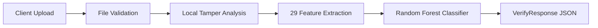

# Document Fraud Detection API Documentation

**Project**: Document Fraud Detection Backend  
**Version**: `0.1.0` (prototype — not production-ready; see [README.md](README.md#limitations))  
**Base URL**: `http://localhost:8000` (local; no hosted deployment exists yet)  
**Interactive Docs**: [Swagger UI (OpenAPI)](http://localhost:8000/docs) | [ReDoc](http://localhost:8000/redoc) | [OpenAPI JSON](http://localhost:8000/openapi.json)

---

## Table of Contents
1. [Overview](#1-overview)
2. [Authentication & Security](#2-authentication--security)
3. [File Validation Rules](#3-file-validation-rules)
4. [Standardized Error Handling](#4-standardized-error-handling)
5. [Endpoints Reference](#5-endpoints-reference)
   - [GET /health](#get-health)
   - [POST /verify](#post-verify)
6. [HTTP Status Codes Catalog](#6-http-status-codes-catalog)
7. [Code Integration Examples](#7-code-integration-examples)
8. [Developer & Testing Guide](#8-developer--testing-guide)

---

## 1. Overview

The **Document Fraud Detection Backend** provides high-throughput forensic verification for identity and financial documents (e.g., payslips, bank statements, Aadhaar/PAN cards). 

### Forensic Engine Workflow


1. **Validation**: Enforces strict file extension, payload size, and structural sanity checks.
2. **Local Tamper Analysis**: Splits the page into 8 x 8 px tiles and measures whether a region's noise, paper colour, sharpness or ink darkness differs from the rest of the same page.
3. **29 Forensic Features** (model v2, schema `local-tamper-v2`): sizes of the largest anomalous regions plus a page-level processing fingerprint (list in [ARCHITECTURE.md](ARCHITECTURE.md)).
4. **Machine Learning Model**: A 300-tree Random Forest scores the 29-dimensional vector. The returned `tamper_risk_score` is the forest's vote fraction for the tampered class — it is **not calibrated** and should not be read as a fraud probability.

---

## 2. Authentication & Security

Protected API endpoints require API key authentication via a custom HTTP request header.

| Parameter | Type | Required | Description |
|---|---|---|---|
| `X-API-Key` | Header | Yes (Protected routes) | Secret API key configured on the server via `API_KEY`. Default: `default-api-key`. |

### Endpoint Access Matrix

| Route | Method | Access Level | Description |
|---|---|---|---|
| `/health` | `GET` | **Public** | System liveness, operational readiness, and version. |
| `/docs` | `GET` | **Public** | Interactive OpenAPI / Swagger UI. |
| `/redoc` | `GET` | **Public** | ReDoc documentation interface. |
| `/openapi.json` | `GET` | **Public** | OpenAPI v3.1 schema specification. |
| `/verify` | `POST` | **Protected** | Document tamper risk analysis and forensic inspection. |

### Authentication Failure Responses

* **Missing Header (HTTP 401 Unauthorized)**:
  ```json
  {
    "success": false,
    "error": "Unauthorized: Missing X-API-Key header",
    "code": 401,
    "detail": "Unauthorized: Missing X-API-Key header"
  }
  ```

* **Invalid API Key (HTTP 403 Forbidden)**:
  ```json
  {
    "success": false,
    "error": "Forbidden: Invalid API Key",
    "code": 403,
    "detail": "Forbidden: Invalid API Key"
  }
  ```

---

## 3. File Validation Rules

The `/verify` endpoint enforces strict multi-stage validation to protect the backend against invalid inputs, oversized uploads, and denial-of-service attempts.

### 1. Allowed File Extensions
Only image and PDF documents commonly used for financial/ID proofs are accepted:
* **Supported**: `.jpg`, `.jpeg`, `.png`, `.pdf` (case-insensitive)
* **Rejected**: `.txt`, `.docx`, `.exe`, `.gif`, `.bmp`, `.webp`, `.csv`, `.zip`, etc.
* **Error**: HTTP 400 Bad Request

### 2. File Size Limits (`MAX_FILE_SIZE`)
* **Default Limit**: `10 MB` (`10,485,760 bytes`), configurable via `.env` (`MAX_FILE_SIZE`).
* **Pre-flight Enforcement**: A request whose `Content-Length` exceeds `MAX_FILE_SIZE` plus 64 KB of multipart framing is rejected before the body is read or parsed.
* **Stream Enforcement**: Chunked uploads without `Content-Length` are counted as they arrive and cut off at the same limit.
* **Exact check**: the file part itself must be at most `MAX_FILE_SIZE` bytes.
* **Error**: HTTP 413 Payload Too Large

### 3. Empty Upload Checks
* Uploads containing 0 bytes are rejected.
* **Error**: HTTP 400 Bad Request

### 4. Image Integrity and Dimensions
* Files with valid extensions but containing unparseable or corrupted bytes are detected during decoding.
* Dimensions are read from the file header **before** decoding: images over `MAX_IMAGE_PIXELS` (40 megapixels by default; for PDFs, page 1 at 200 DPI) are rejected, which blocks decompression bombs.
* Images whose shortest side is under 16 px after scaling to 2000 px (e.g. 1x1, or 20000x10) are rejected.
* Password-protected and empty PDFs are rejected.
* Error messages name the uploaded file, never a server path.
* **Error**: HTTP 400 Bad Request

---

## 4. Standardized Error Handling

All error responses across the entire application adhere to a uniform, predictable JSON contract.

### Error Response Schema
```json
{
  "success": false,
  "error": "Human-readable explanation of error",
  "code": 400,
  "detail": "Human-readable explanation of error",
  "details": null
}
```

* `success` (`boolean`): Always `false` on errors.
* `error` (`string`): Clear, human-readable description of what failed.
* `code` (`integer`): HTTP status code matching the HTTP response header.
* `detail` (`string`): Backward-compatible alias of `error`.
* `details` (`array|object`, optional): Structured validation error diagnostics (provided on HTTP 422).

---

## 5. Endpoints Reference

### GET /health

Readiness check for load balancers, uptime monitoring and smoke tests. Returns `200` only when the fraud model is loaded and `/verify` can serve requests.

* **Authentication**: None (Public)
* **Headers**: None required

#### Success Response (`200 OK`)
```json
{
  "status": "ok",
  "version": "0.1.0",
  "model_loaded": true,
  "model_version": "2.0.0",
  "uptime_seconds": 42.0,
  "detail": null
}
```

#### Degraded Response (`503 Service Unavailable`)
Returned when the model file is missing, unreadable or incompatible. The server keeps running and retries the load on the next `/verify`.
```json
{
  "status": "degraded",
  "version": "0.1.0",
  "model_loaded": false,
  "model_version": null,
  "uptime_seconds": 3.1,
  "detail": "model file not found"
}
```

#### Example Request
```bash
curl -X GET "http://localhost:8000/health"
```

---

### POST /verify

Uploads a single document for automated tampering and forgery detection.

* **Authentication**: Required (`X-API-Key: <YOUR_API_KEY>`)
* **Content-Type**: `multipart/form-data`

#### Request Parameters

| Parameter | Placement | Type | Required | Description |
|---|---|---|---|---|
| `file` | Form Data | Binary (`UploadFile`) | **Yes** | Document file (`.jpg`, `.jpeg`, `.png`, `.pdf`). Max 10MB. |
| `threshold` | Query | Float (`0.0` - `1.0`) | No | Reserved. Validated (out-of-range values return `422`) but **currently ignored**; the server-side `TAMPER_THRESHOLD` (default `0.5`) decides the interpretation text. |

#### Success Response (`200 OK`)
```json
{
  "tamper_risk_score": 0.08,
  "confidence": 0.94,
  "flagged_regions": [],
  "interpretation": "Document verified successfully. Low risk of digital tampering detected (risk score: 0.08, confidence: 0.94)."
}
```

A flagged document (`data/demo/tampered_payslip_01.png`) also returns the suspicious regions:
```json
{
  "tamper_risk_score": 0.7933,
  "confidence": 0.7933,
  "flagged_regions": [
    {"x": 198, "y": 321, "width": 96, "height": 9, "area": 864, "type": "ink"}
  ],
  "interpretation": "Evidence of digital tampering detected (risk score: 0.79, confidence: 0.79). 1 suspicious region(s) located (see flagged_regions)."
}
```

#### Response Field Dictionary

| Field | Type | Range | Description |
|---|---|---|---|
| `tamper_risk_score` | `float` | `0.0` – `1.0` | Uncalibrated Random Forest vote fraction for the tampered class. `≥ TAMPER_THRESHOLD` (default `0.5`) produces a "tampering detected" interpretation. |
| `confidence` | `float` | `0.0` – `1.0` | Classifier confidence in the assigned label. |
| `flagged_regions` | `list[object]` | 0–5 items | Where the page is anomalous, largest first. Returned only when `tamper_risk_score ≥ TAMPER_THRESHOLD` and the loaded model can localise (model v2); otherwise `[]`. See the region fields below. |
| `interpretation` | `string` | – | Human-readable explanation summarizing risk score and findings. |

Each `flagged_regions` item:

| Field | Type | Description |
|---|---|---|
| `x`, `y` | `int` | Top-left corner in pixels of the uploaded image (PDF: page 1 rendered at 200 DPI) |
| `width`, `height` | `int` | Box size in the same pixels |
| `area` | `int` | Pixel area of the anomalous 8 x 8 px tiles inside the box (for an ink run: the box) |
| `type` | `string` | Signal that found it: `noise`, `colour` (rare or new paper colour), `softness` (blurred patch), `ink` (a run of text in a rare darkness), or several joined by `+` |

A region marks an anomaly, not proof of an edit. On held-out synthetic documents a box lands
on 82.1% of visible edits, and 2 of 93 genuine documents get boxes; text overlays whose ink
matches the page are often missed, and boxes are unreliable on pages resampled away from the
training resolution (`logs/localization_report.txt`).

---

## 6. HTTP Status Codes Catalog

### 400 Bad Request — Unsupported File Extension
```http
HTTP/1.1 400 Bad Request
Content-Type: application/json
```
```json
{
  "success": false,
  "error": "Invalid file format: '.txt' is not supported. Allowed formats: jpg, jpeg, png, pdf",
  "code": 400,
  "detail": "Invalid file format: '.txt' is not supported. Allowed formats: jpg, jpeg, png, pdf"
}
```

### 400 Bad Request — Empty File Upload
```http
HTTP/1.1 400 Bad Request
Content-Type: application/json
```
```json
{
  "success": false,
  "error": "Uploaded file is empty",
  "code": 400,
  "detail": "Uploaded file is empty"
}
```

### 400 Bad Request — Missing File Field
```http
HTTP/1.1 400 Bad Request
Content-Type: application/json
```
```json
{
  "success": false,
  "error": "Bad Request: Missing required 'file' parameter",
  "code": 400,
  "detail": "Bad Request: Missing required 'file' parameter"
}
```

### 401 Unauthorized — Missing API Key
```http
HTTP/1.1 401 Unauthorized
Content-Type: application/json
```
```json
{
  "success": false,
  "error": "Unauthorized: Missing X-API-Key header",
  "code": 401,
  "detail": "Unauthorized: Missing X-API-Key header"
}
```

### 403 Forbidden — Invalid API Key
```http
HTTP/1.1 403 Forbidden
Content-Type: application/json
```
```json
{
  "success": false,
  "error": "Forbidden: Invalid API Key",
  "code": 403,
  "detail": "Forbidden: Invalid API Key"
}
```

### 404 Not Found — Invalid Endpoint
```http
HTTP/1.1 404 Not Found
Content-Type: application/json
```
```json
{
  "success": false,
  "error": "Not Found: Endpoint '/api/v1/unknown' does not exist",
  "code": 404,
  "detail": "Not Found: Endpoint '/api/v1/unknown' does not exist"
}
```

### 413 Payload Too Large — Exceeds MAX_FILE_SIZE
```http
HTTP/1.1 413 Payload Too Large
Content-Type: application/json
```
```json
{
  "success": false,
  "error": "Payload Too Large: File size exceeds maximum allowed limit of 10485760 bytes (10MB)",
  "code": 413,
  "detail": "Payload Too Large: File size exceeds maximum allowed limit of 10485760 bytes (10MB)"
}
```

### 422 Unprocessable Entity — Validation Failure
```http
HTTP/1.1 422 Unprocessable Entity
Content-Type: application/json
```
```json
{
  "success": false,
  "error": "Validation error: query -> threshold: Input should be less than or equal to 1",
  "code": 422,
  "detail": "query -> threshold: Input should be less than or equal to 1",
  "details": [
    {
      "type": "less_than_equal",
      "loc": ["query", "threshold"],
      "msg": "Input should be less than or equal to 1",
      "input": 999.0,
      "ctx": {"le": 1.0}
    }
  ]
}
```

### 500 Internal Server Error — Server Exception
```http
HTTP/1.1 500 Internal Server Error
Content-Type: application/json
```
```json
{
  "success": false,
  "error": "Internal Server Error: unexpected error during verification (request id 3f2a9c1b7d4e)",
  "code": 500,
  "detail": "Internal Server Error: unexpected error during verification (request id 3f2a9c1b7d4e)"
}
```
The exception details are written to the server log under the same request ID and are never returned to the client.

### 503 Service Unavailable — Model Not Loaded
```json
{
  "success": false,
  "error": "Service Unavailable: Fraud detection model is not available (model file not found)",
  "code": 503,
  "detail": "Service Unavailable: Fraud detection model is not available (model file not found)"
}
```

### Request IDs
Every response includes an `X-Request-ID` header. Send your own (up to 64 characters of `A-Z a-z 0-9 . _ -`) to correlate client and server logs; otherwise the server generates one.

---

## 7. Code Integration Examples

### cURL
```bash
curl -X POST "http://localhost:8000/verify" \
  -H "X-API-Key: default-api-key" \
  -F "file=@/path/to/document.png;type=image/png"
```

### Python (`requests`)
```python
import requests

url = "http://localhost:8000/verify"
headers = {"X-API-Key": "default-api-key"}
files = {"file": ("payslip_001.png", open("data/synthetic/genuine/payslip_001.png", "rb"), "image/png")}

response = requests.post(url, headers=headers, files=files)
if response.status_code == 200:
    data = response.json()
    print("Risk Score:", data["tamper_risk_score"])
    print("Verdict:", data["interpretation"])
else:
    error_info = response.json()
    print(f"Error [{error_info['code']}]: {error_info['error']}")
```

### JavaScript / Node.js (`fetch`)
```javascript
const fs = require('fs');
const FormData = require('form-data');
const fetch = require('node-fetch');

async function verifyDocument(filePath) {
  const form = new FormData();
  form.append('file', fs.createReadStream(filePath));

  const response = await fetch('http://localhost:8000/verify', {
    method: 'POST',
    headers: {
      'X-API-Key': 'default-api-key',
      ...form.getHeaders()
    },
    body: form
  });

  const result = await response.json();
  if (result.success !== false) {
    console.log(`Tamper Risk: ${result.tamper_risk_score} (Confidence: ${result.confidence})`);
  } else {
    console.error(`Verification Failed [${result.code}]: ${result.error}`);
  }
}
```

---

## 8. Developer & Testing Guide

### Running Server Locally
```bash
# Start FastAPI application with live reload
uvicorn backend.main:app --host 127.0.0.1 --port 8000 --reload
```

### Running Test Suites
```bash
# Run all tests
pytest -v

# Run verification and error handling tests specifically
pytest tests/test_verify.py tests/test_error_handlers.py -v
```

### Environment Configuration (`.env`)
```ini
API_KEY=default-api-key
MAX_FILE_SIZE=10485760
MODEL_PATH=data/models/fraud_model.pkl
```
